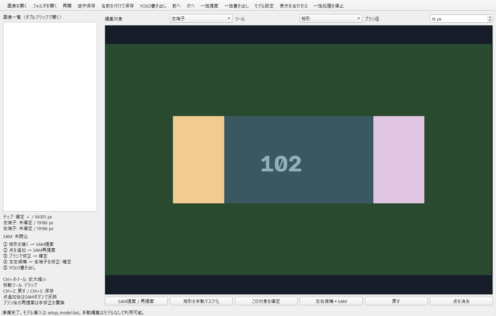
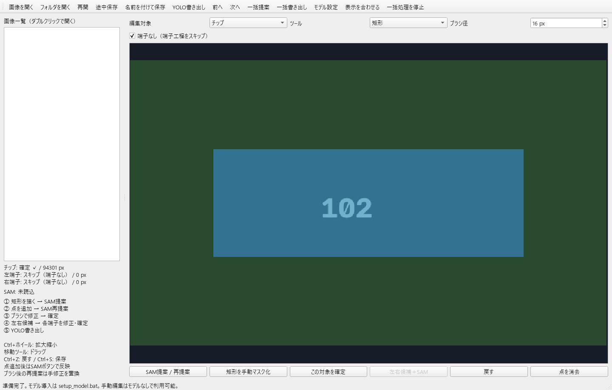

# Chip Annotator — Windows / Python / PySide6

チップ全体を矩形指定し、事前学習済みMobileSAMでマスクを提案、手修正して確定した後に、左右の白い端子をOpenCV＋SAMで抽出するデスクトップアプリです。追加学習は不要です。

## 起動（Windows 10/11 x64、Python 3.12 x64推奨）

1. このリポジトリをclone、または「Code → Download ZIP」で取得して展開します。
2. Python 3.12 x64をPython Launcher付きでインストールします。`py -3.12 --version`で確認できます。
3. `setup.bat`をダブルクリックします。短いパスにアプリ専用のPython環境を作成します。長い展開先でも環境のパスは長くなりません。
4. `setup_model.bat`を実行します。RTX 5070 Ti向けにPyTorch 2.7.1 / torchvision 0.22.1のCUDA 12.8版、timm、公式MobileSAMソース・重みをダウンロードします。数GBの通信・十分なディスク空き容量が必要です。
5. `launch.bat`を実行します。

モデルなしでも、矩形・ブラシ・消しゴムでアノテーション、途中保存、YOLO出力ができます。CPU専用導入はコマンドプロンプトで`setup_model.bat cpu`。CPU版導入後は「モデル設定」で`cpu`を選択してください。

CUDA版PyTorchに対応するNVIDIAドライバーが必要です。CUDA Toolkitの別途インストールは通常不要です。RTX 50系では古いCUDA版PyTorchに対応カーネルが含まれないことがあります。`tools/diagnose.py`は実際にCUDA行列演算を実行して確認します。

PyTorchは公式配布元から分割取得し、公式インデックスのSHA256を検証してから導入します。通信失敗時は`setup_model.bat`の再実行で取得済み部分を再利用します。共通環境の`cache/`にキャッシュを保持するため、初回セットアップには約10GB以上の空きを推奨します。導入完了後はこのキャッシュフォルダを削除できます。通常のpipを使う場合は`python_env.bat -m pip install torch==2.7.1 torchvision==0.22.1 --index-url https://download.pytorch.org/whl/cu128`で同じ版を導入できます。

## 操作

1. **画像を開く**、または**フォルダを開く**。PNG / JPEG / BMP / TIFF / WebPに対応します。フォルダは直下のファイルを名前順に列挙します。
2. 編集対象を**チップ**、ツールを**矩形**にしてドラッグします。
3. **SAM提案 / 再提案**。モデルと画像特徴の計算は別スレッドで実行します。
4. **正点 ＋ / 負点 −**を追加してSAMを再提案します。正点ツールで右クリックしても負点になります。点は自動推論せず、ボタンでまとめて反映します。
5. **ブラシ / 消しゴム**で直接修正します。ブラシ径は画像上のピクセル数です。SAM再提案は現在のマスクを置換するため確認を表示します。ブラシ編集をSAMの入力マスクに変換する方式ではありません。
6. **この対象を確定**。次に**左右候補＋SAM**で左右を提案します。
7. 編集対象で**左端子 / 右端子**を切り替え、それぞれ独立に正負点、矩形、ブラシで修正して確定します。候補検出に失敗した場合も、端子対象を選んで矩形を描きSAMを実行できます。
8. **YOLO書き出し**で出力先フォルダを指定します。通常はチップ1個＋端子2個を出力します。端子なしの場合はチップ1個だけを出力できます。

**端子のないチップ**: 画面上部の「端子なし（端子工程をスキップ）」にチェックし、チップだけを確定して書き出します。端子候補の推定や端子の確定は不要です。この設定は画像ごとに途中保存・再開されます。チェックを外すと端子工程へ戻り、左右端子の確認・確定が必要になります。切替はUndoでも戻せます。

スキップ中は端子の選択・提案を無効にし、端子マスクを非表示にします。以前の端子マスクは修正再開用の下書きとしてプロジェクト内に保持しますが、YOLOラベル・ポリゴンからは除外します。出力する左右端子PNGは空（全ピクセル0）とし、同じ画像の以前の出力も更新します。

チップを編集すると、チップと両端子の確定を解除します。端子マスク自体は比較・修正のため保持します。端子だけを編集した場合、他の確定済み対象は保持します。SAMで提案する端子はチップ内に制限しますが、ブラシでは境界外も修正可能です。chipとterminalの重なりはそのまま保存します。

**Ctrl+ホイール**で拡大縮小、**移動**ツールでドラッグ、**F**で全体表示、**Ctrl+Z**で戻す（直前15操作）、**Ctrl+S**で途中保存、**Ctrl+O**で画像を開きます。点は「点を消去」で対象ごとに消せます。編集対象のマスクを濃く、他を薄く表示します。チップは青、左端子は橙、右端子は紫です。

## 途中保存・再開

`.chipproj`はZIP形式の自己完結したプロジェクトです。読み込んだ画像のRGBピクセルを損失なしPNGにし、3枚のバイナリマスク、矩形、正負点、各確定状態、元画像パスを格納します。元ファイルを移動しても再開できます。保存は一時ファイルを経由して置換します。

「途中保存」で任意の場所へ保存できます。初期保存先は画像フォルダの`.chipannotator/`です。**再開**で任意の`.chipproj`を開きます。画像を開く際、標準の`.chipannotator/`内に対応する保存があれば自動で読みます。別の場所に保存した場合は「再開」を使ってください。

編集中は60秒ごとに`.autosave.chipproj`を別途保存します。確定保存を上書きしません。クラッシュ後は「再開」から自動保存ファイルを明示的に選択します。未保存のまま画像移動・終了すると保存確認が出ます。画像はOpenCVの8bit RGBとして扱い、アルファ・EXIF・TIFF多ページ・元の圧縮バイト列は保持しません。学習用画像とマスクは、この読み込み後の同じ座標系になります。

## 画像フォルダの一括処理

**前へ / 次へ**で順に確認できます。

**一括提案**は、基準画像の矩形を画像幅・高さで正規化し、フォルダ内の画像に適用します。同じ配置・向きで撮影した画像向けです。チップSAM→端子候補→端子SAMを処理し、結果を`.chipannotator/*.chipproj`へ**未確定の下書き**として保存します。既存のプロジェクトはスキップします。端子だけ失敗した場合もチップの下書きを保存し、`batch_report.txt`にエラーを残します。

チップ位置が画像ごとに異なる場合は、各画像を開いて個別に矩形指定してください。一括提案は対象位置を自動検出する機能ではありません。実行中は編集をロックし、「一括処理を停止」で現在の画像完了後に停止します。途中までの結果は残り、再実行で続きから処理できます。

一括提案は基準画像の「端子なし」設定を全対象へ適用し、オンの場合は端子推定を実行しません。端子あり・なしが混在する場合は、各下書きを開いて画像ごとに切り替えてください。下書きを開き、チップと必要な端子を確認・確定して途中保存します。**一括書き出し**で、その`.chipproj`フォルダとYOLO出力先を選ぶと確定済みプロジェクトのみを書き出します。未確定はスキップし、`export_report.txt`へ記録します。自動保存ファイルは一括書き出しから除外します。

## 出力

```text
dataset/
  data.yaml
  images/<画像名_パスハッシュ>.png
  labels/<画像名_パスハッシュ>.txt
  masks/<画像名_パスハッシュ>_chip.png
  masks/<画像名_パスハッシュ>_left.png
  masks/<画像名_パスハッシュ>_right.png
  polygons/<画像名_パスハッシュ>.json
  projects/<画像名_パスハッシュ>.chipproj
```

ラベルはYOLO instance segmentationの`class x1 y1 x2 y2 ...`形式、座標は幅・高さで0〜1に正規化します。通常は各画像に3行、端子スキップ時はchipの1行を出力し、クラスIDは**0=chip、1=terminal**です。左右は同じterminalクラスの別インスタンスです。左右情報はファイル名とJSONに保持します。同名画像の衝突は元パスのハッシュで防ぎます。同じ元パスからの再書き出しは同じキーを置換します。

PNGマスクは背景0、対象255で、各インスタンスを独立保存します。chipからterminalを差し引きません。YOLO学習側でも重なりを維持したい場合は、利用する学習実装の`overlap_mask=False`等の設定を確認してください。

**YOLOポリゴンの制限**: 1インスタンス1行にするため、離れた領域は最近傍の輪郭点間を往復する橋で連結します。穴はYOLO形式で表現できず塗りつぶされます。極細の線・単独ピクセルも完全には表現できません。PNGマスクは厳密に保持し、ポリゴンJSONには穴数、領域数、ポリゴンを再描画したマスクとのIoUを記録します。変換差分があれば画面にも表示します。精密な形状はPNGを正とし、学習前にJSONの診断値を確認してください。

`data.yaml`は初回のみ作成します。既存ファイルは保持します。`path`は出力先の絶対パスです。データセットを移動した際は編集してください。初期値は内容確認のためtrain/valとも`images`です。実際の学習では画像を別々のtrain/valへ分けて編集してください。1つのYOLOデータセット内で本アプリと異なるクラスID定義を混ぜないでください。

## 端子推定と対象範囲

確定chipマスクの主成分軸を求め、その両端38%以内で高輝度・低彩度の領域を探索します。連結領域の面積・明るさ・充填率で候補を選び、候補の矩形と内部点をMobileSAMへ渡します。SAMはRGB画像を使用します。横長以外にも主成分軸で対応しますが、ほぼ正方形、極端な反射、白い印字、暗い端子、複数チップ、端子が3個以上ある部品には手修正が必要です。

左右は主軸の画面左端／右端です。完全な縦向きでは上／下をleft/rightに割り当てます。1画像に1チップと2端子を扱う仕様です。

## WinError 206への対応（v1.1.1）

展開先にPythonライブラリを直接入れると、PySide6内の深いフォルダ名がWindowsのパス長制限に達することがあります。共通の`environment.bat`でPython環境・一時ファイル・ダウンロードキャッシュを短い場所へまとめました。通常の保存先は`%LOCALAPPDATA%/CA`です。必要な場合は環境変数`CHIPANNOTATOR_HOME`で、より短い書き込み可能なフォルダを指定できます。Python 3.12は`py`または`python`から検出します。画面に必要なPySide6 Essentialsのみを導入します。

## エラー対策

- **モデルがありません**: `setup_model.bat`を実行、または「モデル設定」で公式`mobile_sam.pt`を指定します。モデルは初回推論時に読み込みます。アプリ起動時に勝手にダウンロードしません。
- **CUDAを利用できない / no kernel image**: `setup_model.bat`でCUDA 12.8版を導入し、NVIDIAドライバーを確認。診断は`python_env.bat tools\diagnose.py`。明示的にCPUへ切り替えることもできます。`auto`はCUDAが利用可能と判定されたときCUDAを選び、推論失敗時に無言でCPUへ切り替えません。
- **メモリ不足**: 他のGPUアプリを閉じる、画像を小さくする、またはCPUを選択。SAMエンコーダは内部で長辺1024へ変換しますが、出力マスクは元画像解像度なので超巨大画像にはRAMも必要です。
- **白い候補がない / SAM空マスク**: 矩形・点を調整、またはブラシで手動作成します。
- **保存できない**: 書き込み可能なフォルダへ「名前を付けて保存」。未確定・空マスクはYOLO書き出しできません。
- **導入の通信失敗**: 接続・プロキシ・空き容量を確認し再実行。オフライン環境は別PCで対応wheelと公式重みを用意し、同じ依存関係を導入してください。

詳細エラーはプロジェクト直下の`chip_annotator.log`に記録します。

## テスト

`test.bat`で単体テストと画面操作テストを実行できます（画面テストはQt offscreen）。端子推定、回転画像、保存往復、重なりを含むYOLOの3行出力、未確定の拒否、穴・複数領域、モデル不足、矩形・消しゴム・Undo、別スレッドの完了通知などを確認します。

実モデルの任意検証:

```bat
python_env.bat tools\smoke_sam.py --weights models\mobile_sam.pt --device cuda --output verification_output
```

`samples/synthetic_chip.png`と`samples/terminal_free_synthetic.png`は人工的なテスト画像です。実写真・作業用マスク・モデル本体・このPC専用の設定はリポジトリに含めません。`tests/test_user_image.py`はローカル専用の実写真がある場合だけ実行し、写真がなければスキップします。





## 構成・ライセンス

`chipannotator/core.py`: 画像・保存・候補推定・YOLO変換。`sam_backend.py`: MobileSAM・CUDA。`gui.py`: PySide6画面・編集・ワーカー・一括処理。`app.py`: 起動。

アプリの独自コードは同梱MIT Licenseで提供します。依存ライブラリ・モデルはそれぞれのライセンスに従います。モデルと第三者ソースはリポジトリに含めず、セットアップ時に公式リポジトリの固定リビジョンから導入します。取得元・チェックサムは`models/provenance.json`へ記録します。

一次資料:
- MobileSAM: https://github.com/ChaoningZhang/MobileSAM
- PyTorch CUDA版の公式インストール一覧: https://pytorch.org/get-started/previous-versions/
- YOLO segmentation形式: https://docs.ultralytics.com/datasets/segment/
- PySide6ライセンス: https://doc.qt.io/qtforpython-6/licenses.html
